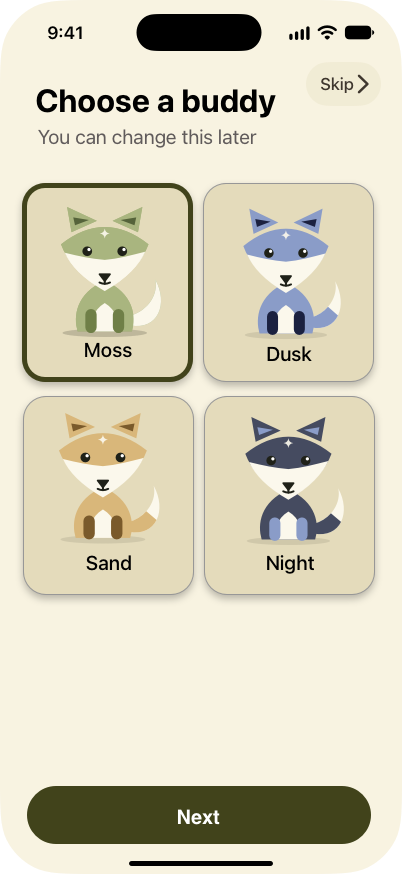
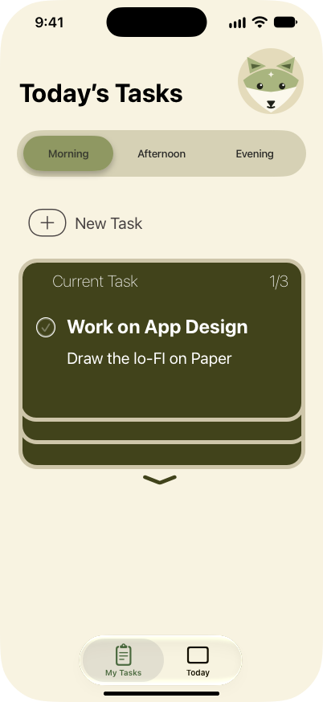
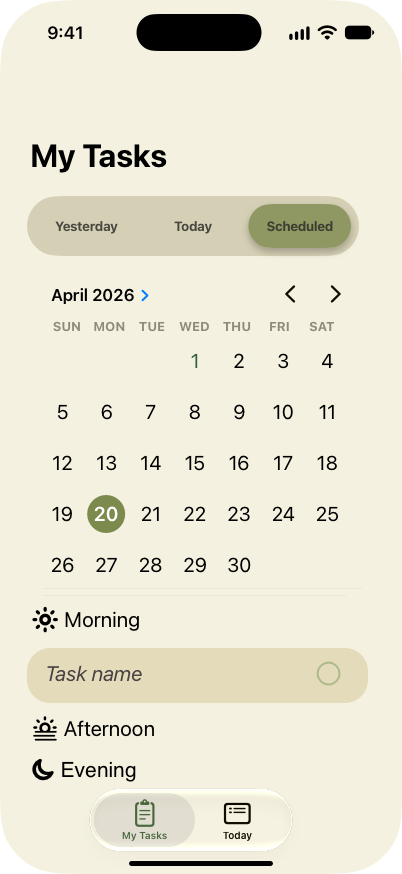
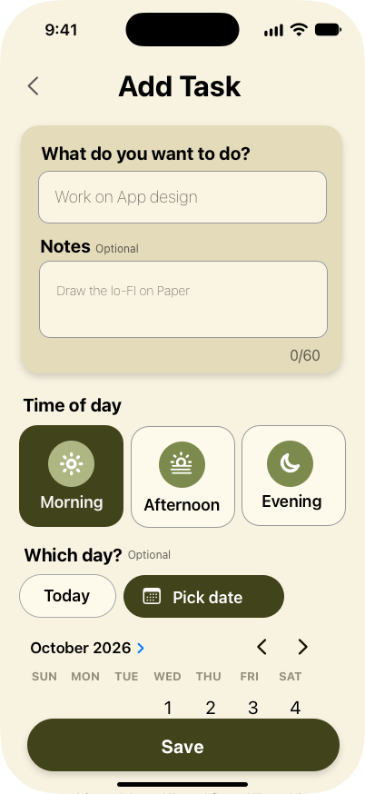
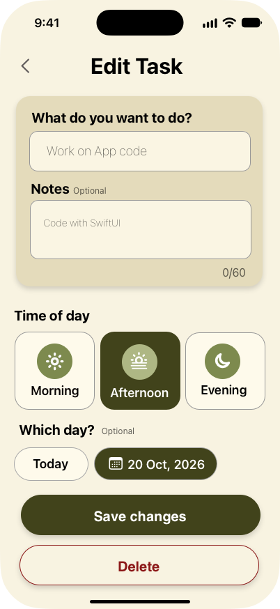
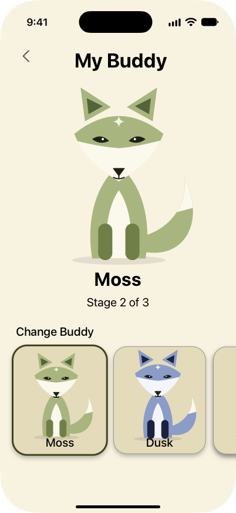

# TASQU 🚀

**TASQU** is an iOS application project developed using Apple's Xcode development environment.

## 📱 About The Project

TASQU is an app that helps individuals with level 1 Autism Spectrum Disorder manage their daily tasks in a way that feels intuitive, and easy to use.

This repository contains the Xcode project and its associated source files, providing the foundation for developing, running, and maintaining the application.

## 📸 Screenshots

<table>
  <tr>
    <td align="center"><br/><sub><b>Choose a Buddy</b></sub></td>
    <td align="center"><br/><sub><b>Today</b></sub></td>
    <td align="center"><br/><sub><b>Today</b></sub></td>
    <td align="center"><br/><sub><b>Add Task</b></sub></td>
    <td align="center"><br/><sub><b>Edit Task</b></sub>
    <td align="center"><br/><sub><b>My Buddy</b></sub></td>
</td>
  </tr>
</table>

## 🛠️ Built With

- **Xcode** – Apple's integrated development environment.
- **Swift** – Application development language (if applicable to the project).
- **iOS SDK** – Apple's software development kit for iOS applications.

## 📂 Project Structure

```text
TheLaunch/
│
├── TheLaunch/
│   └── Application source files
│
├── TheLaunch.xcodeproj/
│   └── Xcode project configuration
│
└── README.md
```

## 🚀 Getting Started

Follow these instructions to get a local copy of the project running.

### Prerequisites

- A Mac running macOS.
- Xcode installed.
- An iOS Simulator or a compatible iPhone.
- Git installed.

### Installation

**1. Clone the repository**

```bash
git clone https://github.com/Deemabakhyer/TheLaunch.git
```

**2. Navigate to the project directory**

```bash
cd TheLaunch
```

**3. Open the Xcode project**

```bash
open TheLaunch.xcodeproj
```

**4. Build and run**

1. Select the `TheLaunch` scheme in Xcode.
2. Choose an iOS Simulator or connected device.
3. Press `Cmd + R` to build and run the application.

## 💻 Development

You can explore and modify the application through Xcode.

To contribute to development:

1. Clone the repository.
2. Create a new branch for your changes.
3. Implement and test your updates.
4. Commit your changes.
5. Submit a pull request.

## 🤝 Contributing

Contributions, suggestions, and improvements are welcome!

If you find a bug or have an idea for improvement, feel free to open an issue or submit a pull request.

## 👩‍💻 Author

**Deema Bakhyer**
GitHub: [@Deemabakhyer](https://github.com/Deemabakhyer)

**Hadeel Awaji**
GitHub: [@HadeelAwaji](https://github.com/HadeelAwaji)

**Haneen Alshyaji**
GitHub: [@ha39-cell](https://github.com/ha39-cell)

**Norah Alosaimi**
GitHub: [@NorahALosaimi](https://github.com/NorahALosaimi)

**Reema Alotaibi**
GitHub: [@reema273100-dotcom](https://github.com/reema273100-dotcom)

## 📄 License

No license has currently been specified for this repository. Please contact the repository owner regarding permissions for reuse and distribution.
